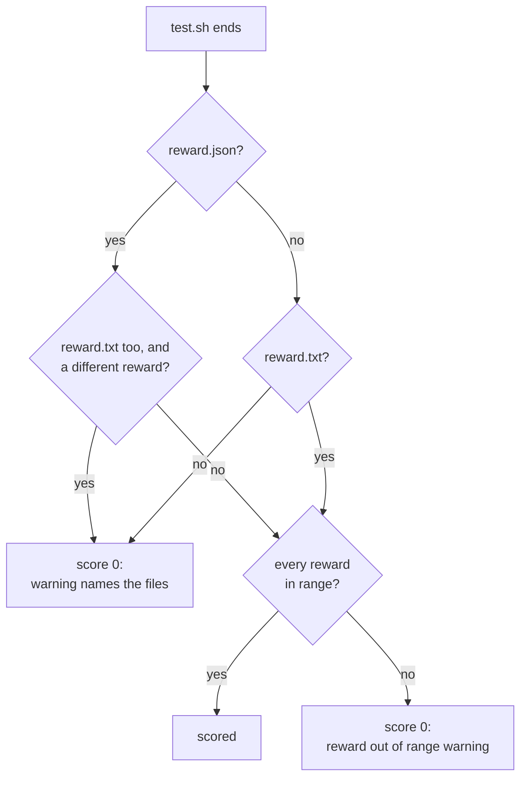

# Verifier

```bash
#!/bin/bash
# verifier/test.sh
REWARD=0
if [ "$(cat /app/hello.txt 2>/dev/null | tr -d '\n')" = "Hello, world!" ]; then
    REWARD=1
fi
echo "$REWARD" > /logs/verifier/reward.txt
```

After the agent stops, BenchFlow copies `verifier/` to `/verifier` in the sandbox and runs `verifier/test.sh`. The script checks the agent's work and writes a reward. An imported task.toml task's `tests/` goes to `/tests` instead.

Use absolute paths in `test.sh`, so its working directory doesn't matter.

## Reward files

| File | Holds |
|---|---|
| `/logs/verifier/reward.txt` | One number, `0.0` to `1.0` |
| `/logs/verifier/reward.json` | `{"reward": 0.75}`, or named metrics such as `{"tests": 1.0, "style": 0.5}` |

If both exist, BenchFlow uses `reward.json`. Its `reward` must equal the number in `reward.txt`, or the trial scores 0 with a warning naming both files.

BenchFlow clears both files before `test.sh` starts, so a reward always comes from this run.

## Exit codes

| `test.sh` | Result |
|---|---|
| Writes a reward, exits 0 | Scored |
| Writes a reward, exits nonzero | Scored; the log notes the exit code. pytest exits 1 when a test fails, so this is common. |
| Writes no reward | Score 0, with a warning naming the missing reward files |
| Times out | Score 0, even if a passing reward was written first |



## Reward rules

- `reward.json` may hold a numeric `reward` with other keys, or only named metrics.
- Beside a numeric `reward`, keys that are not numbers, such as `"feature1_passed": true`, are kept and not scored. A score in `reward.txt` counts as that `reward` for a `reward.json` that has none and declares no aggregate, so `1` in `reward.txt` beside `{"answer": "Empowering"}` scores 1 and keeps `answer`.
- Without a numeric `reward` in either file, every top-level key must be a number. The reward comes from `outputs.aggregate_policy` in `verifier.md`.
- Every other top-level number in `reward.json` is a metric, held to the reward range. Write details that are not scores, such as a seed, to `reward-details.json`.
- A reward outside `[0, 1]` is never clamped. The trial scores 0 with a `reward out of range: ...` warning, and `result.json` keeps the raw value under `reward_out_of_range_info`.
- To score negative rewards on purpose, widen the range: `verifier.reward_range: [-1.0, 1.0]`.
- A missing, empty, malformed, unsafe, non-finite or larger-than-16-MiB reward file gives score 0 and a warning. A malformed JSON file beside a valid text file never falls back to a higher score.
- `/logs/verifier/reward-details.json` is kept when present.

## How test.sh runs

| | |
|---|---|
| Interpreter | The one its `#!` line names. Without one: bash, or `sh` if the image has no bash. |
| User | `verifier.user`, default root |
| Time limit | `verifier.timeout_sec`, default 600 |
| Network | `verifier.network_mode`: `no-network` or `public`; see [Network policies](./network-policies.md) |
| Where | The `main` container, or `verifier.service`; see [Environment](./environment.md#run-the-verifier-in-another-service) |

To use the protected pytest runner, name `$BENCHFLOW_PYTEST` in the tests folder (a comment is enough) or a `[verifier] env` value. BenchFlow prepares it even without plugin pins or `--ctrf`. If stdout is redirected into `reward.txt`, the runner sends its report to stderr so the scalar reward stays readable. See [the runner and guard rules](../sandboxes/threat-model.md#pytest-plugin-guard).

A reported plugin-guard problem gives score 0 with a neutral warning. A `registered` marker cannot cancel failure text or a failed marker check. With no reported problem, normal scoring continues. The verifier user can access the markers and their signing key, so BenchFlow does not independently prove that the guard loaded; code the tests execute could suppress it and its reports together.

These rules decide the script-verifier assessment. A task with automatic rubric review still needs a completed reviewer verdict for its final score. Capture or export failures in that review remain unscored, with the failed step named. Earlier verifier code can alter the captured workspace and cause such a failure; closing that path is deferred to 0.8.4.

Before `test.sh` runs, BenchFlow hardens the sandbox against tampering. It kills the agent user's processes, cleans `PATH` and `PYTHONPATH`, and guards pytest against planted plugins. See [Sandbox hardening](../sandboxes/security.md).

`test.sh` itself is trusted: what it runs or installs runs as the verifier's user, and a run in which no pytest reached BenchFlow's plugin guard is scored as `test.sh` wrote it. If it installs, builds or imports from files the agent wrote (`pip install -e .` of the workspace, a requirements file there, a module of the agent's that the tests import), that is the agent's code running in the grader, and it can change the result. A `pytest.py` or another test-runner module the agent added to the workspace is removed before grading, so `cd /app && python -m pytest` runs the real pytest. Install test tools into the image or pin them in `[verifier] pytest_plugin_releases`, and run the tests with `$BENCHFLOW_PYTEST`. BenchFlow prepares `$BENCHFLOW_PYTEST` only when a file of the tests folder or a `[verifier] env` value names it, so name it in `test.sh`, not only in a script inside the image. See [The task's test script is trusted](../sandboxes/threat-model.md#the-tasks-test-script-is-trusted).

For a stronger boundary, run the verifier in a fresh sandbox: [Separate verifier](./separate-verifier.md).

## Environment variables

```yaml
verifier:
  env:
    MODEL_NAME: claude-haiku-4-5
    OPENAI_API_KEY: "${OPENAI_API_KEY}"
```

`verifier.env` sets variables for `test.sh`. A value that reads your shell, such as `${OPENAI_API_KEY}`, makes the run refuse the task unless you allow that name:

```bash
bench run tasks/my-task --allow-task-env OPENAI_API_KEY
```

`${NAME:-default}` gets the default when the name is not allowed. `bench check` names every value the run would refuse.

## Declare a strategy

To say how the task is scored, add `verifier/verifier.md`. Its frontmatter lists one or more `strategies`. `default_strategy` picks the one that runs; without it, the first one runs.

```markdown
---
document_version: "0.3"
verifier:
  name: my-task-verifier
  default_strategy: deterministic
  strategies:
    deterministic:
      type: script
      command: ./test.sh
  outputs:
    reward_text: /logs/verifier/reward.txt
    reward_json: /logs/verifier/reward.json
---

## verifier intent

What the verifier measures and which task outputs it reads.
```

| `type` | Required | Notes |
|---|---|---|
| `script` | `command` | Runs as `cd /verifier && <command>`. Script files the command names must exist in `verifier/`. |
| `llm-judge` | `rubric` | Optional `model`, `input_dir`, and `context` or `context_file` (not both). See [LLM judge](../judging/llm-judge.md). |
| `criteria-runner` | `root` | Optional `entrypoint` (default `reward.py`) and `criteria`. Paths must stay inside `verifier/`. |
| `agent-judge` | `role`, `isolation: verifier-only`, `inputs` | `role` must match a `## role:<name>` section in the body of `verifier.md` |
| `ors-episode` | `inputs` | Optional `format`: `json`, `jsonl` or `auto` |

An unknown `type` fails to parse. `bench check` also fails a strategy that can't run, such as a `script` whose file is missing or an `llm-judge` whose rubric does not exist. A sixth type, `taskmd`, is written by BenchFlow for [draft-2 tasks](./taskmd-draft-2.md); don't write it by hand.

`outputs` names the reward files; the defaults are shown above. `details_json` and `aggregate_policy` are optional:

```yaml
  outputs:
    reward_json: /logs/verifier/reward.json
    aggregate_policy:
      field: reward
      method: weighted_mean      # see the table below
      weights: {tests: 0.8, style: 0.2}
```

| `method` | Reward |
|---|---|
| `mean` | The mean of the metrics |
| `weighted_mean` | The weighted mean; equal weights without `weights` |
| `weighted_sum` | The weighted sum; needs `weights` |
| `all_pass`, `any_pass` | 1 if all (or any) metrics are at least 0.5, else 0 |
| `threshold` | 1 if the weighted mean is at least `threshold`, else 0 |

`field` must be `reward`. `fallback` is accepted in place of `method`.

Without `verifier.md`, BenchFlow runs `verifier/test.sh`. With it, `test.sh` is optional, for example when a `criteria-runner` strategy does the scoring.

A larger example, with a rubric that combines three strategies, is in the [task package reference](../reference/task-package.md#a-verifier-with-several-strategies).

## What the agent never sees

- `verifier/` arrives after the agent stops: its tests, rubrics and judge prompts.
- Judge models and keys belong to the verifier. The agent never gets them.
- A strategy BenchFlow can't run fails before scoring starts.

## Next steps

- [Separate verifier](./separate-verifier.md): grade in a fresh sandbox.
- [LLM judge](../judging/llm-judge.md): rubric-scored tasks.
- [Verifier recovery](./verifier-recovery.md): grade again without rerunning the agent.
- [Regrade](../jobs/regrade.md): rerun verifiers on finished trials.
