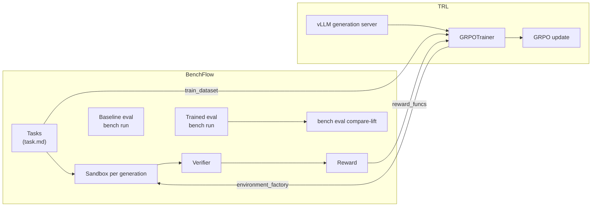

# Train on BenchFlow tasks with TRL GRPO

This recipe trains `Qwen/Qwen3-4B` with TRL's GRPO on BenchFlow tasks. It then measures the lift on held-out tasks against the base model.

> **Not yet run end to end.** BenchFlow's tests cover the TRL adapter's shapes, not a training run. Do the tiny run in step 4 first, and treat the numbers as yours to establish.

BenchFlow loads the tasks, runs the sandboxes and the verifiers, keeps the artifacts and reports the lift. TRL does the optimization.

The recipe uses two public data-agent task suites:

| Use | Repository | Commit | Tasks |
| --- | --- | --- | --- |
| Training | `benchflow/data_agent_rl_environment_train` | `34ff63c91731df6b3670bfcd7e3d44e6790ddc48` | 2,238 |
| Held-out eval | `benchflow/data_agent_rl_environment_eval` | `0ea976c79e3248c85737c4f7363484e4d47ce287` | 366 |

Both are `task.md` packages. For difficulty, use each repository's `manifest.parquet`; the per-task difficulty field is not reliable.



## 1. Install and set credentials

```bash
uv sync --locked --extra trl --extra sandbox-daytona   # in a BenchFlow checkout
```

Outside a checkout, `pip install 'benchflow[trl,sandbox-daytona]'` installs the same extras.

Set these in your shell:

| Variable | Used for |
| --- | --- |
| `HF_TOKEN` | Downloading the task repositories from Hugging Face. |
| `DAYTONA_API_KEY` | Daytona sandboxes. |
| `OPENAI_API_KEY` | The key your vLLM server accepts, any value if you started it without `--api-key`. BenchFlow's `vllm` provider requires it and sends it as the API key. |

## 2. Download the tasks

Pin both repositories to a commit before you spend anything. `bench tasks snapshot-hf` also writes a `.benchflow-source.json` file, so every later result records which commit it used.

```bash
bench tasks snapshot-hf \
  benchflow/data_agent_rl_environment_train \
  .local/data-agent-train \
  --path tasks \
  --revision 34ff63c91731df6b3670bfcd7e3d44e6790ddc48 \
  --overwrite

bench tasks snapshot-hf \
  benchflow/data_agent_rl_environment_eval \
  .local/data-agent-eval \
  --path tasks \
  --revision 0ea976c79e3248c85737c4f7363484e4d47ce287 \
  --overwrite
```

Check one held-out task:

```bash
bench check .local/data-agent-eval/0000_369_369503_qa_1
```

## 3. Measure the base model

Serve the base model with an OpenAI-compatible server:

```bash
vllm serve Qwen/Qwen3-4B --port 8001
```

vLLM serves it as `Qwen/Qwen3-4B`, so the BenchFlow model id is `vllm/Qwen/Qwen3-4B`. BenchFlow strips the `vllm/` prefix and asks the server for the rest.

The `vllm` provider has no default address. Pass the server's `/v1` URL with `--env BENCHFLOW_PROVIDER_BASE_URL`.

Try one task first:

```bash
bench run .local/data-agent-eval \
  --include 0000_369_369503_qa_1 \
  --agent openhands \
  --model vllm/Qwen/Qwen3-4B \
  --env BENCHFLOW_PROVIDER_BASE_URL=http://<host>:8001/v1 \
  --sandbox daytona \
  --concurrency 1 \
  --jobs-dir experiments/qwen3-4b-grpo/jobs/baseline-smoke
```

On Daytona, the model calls leave from inside the sandbox. `<host>` must be reachable from there, not only from your machine.

Then run the whole held-out suite:

```bash
bench run .local/data-agent-eval \
  --agent openhands \
  --model vllm/Qwen/Qwen3-4B \
  --env BENCHFLOW_PROVIDER_BASE_URL=http://<host>:8001/v1 \
  --sandbox daytona \
  --concurrency 32 \
  --usage-tracking required \
  --health-summary-out experiments/qwen3-4b-grpo/reports/baseline-health.json \
  --canonicalize one-healthy-per-task \
  --canonical-selection-out experiments/qwen3-4b-grpo/reports/baseline-canonical.json \
  --jobs-dir experiments/qwen3-4b-grpo/jobs/baseline
```

Use the same command for the trained model in step 5, changing only the model and the output paths.

## 4. Train

`BenchFlowSpec` turns the task folder into TRL's dataset, environment and reward function. Save this as `experiments/qwen3-4b-grpo/scripts/train_grpo.py`:

```python
from trl import GRPOConfig, GRPOTrainer

from benchflow.integrations.trl import BashHarnessConfig, BenchFlowSpec

spec = BenchFlowSpec(
    tasks_dir=".local/data-agent-train",
    bash_harness=BashHarnessConfig(
        environment="daytona",
        jobs_dir="experiments/qwen3-4b-grpo/jobs/grpo-train",
        submit_path="/workdir/answer.txt",
    ),
)

trainer = GRPOTrainer(
    model="Qwen/Qwen3-4B",
    args=GRPOConfig(
        learning_rate=1e-6,
        num_generations=8,
        max_completion_length=2048,
        max_steps=300,
        max_tool_calling_iterations=25,
        log_completions=True,
        use_vllm=True,
        vllm_mode="server",
        vllm_server_base_url="http://localhost:8000",
        output_dir="experiments/qwen3-4b-grpo/checkpoints",
    ),
    train_dataset=spec.train_dataset,
    environment_factory=spec.environment_factory,
    reward_funcs=spec.reward_funcs,
)

trainer.train()
```

This recipe has not been run end to end, so start small. First, do a tiny run: `max_steps=2`, `num_generations=2`, `BenchFlowSpec(..., max_tasks=4)`, and `BashHarnessConfig(environment="docker", jobs_dir=".local/grpo-smoke")`.

Then run generation and training on separate GPUs. `train_grpo.py` and the Accelerate config are yours; BenchFlow ships neither.

```bash
# Terminal 1: TRL's generation server
CUDA_VISIBLE_DEVICES=2,3 trl vllm-serve \
  --model Qwen/Qwen3-4B \
  --tensor-parallel-size 2 \
  --port 8000

# Terminal 2: training
CUDA_VISIBLE_DEVICES=0,1 accelerate launch \
  --config_file <accelerate-deepspeed-zero2.yaml> \
  --num_processes 2 \
  experiments/qwen3-4b-grpo/scripts/train_grpo.py
```

`trl vllm-serve` serves TRL's trainer, not BenchFlow's eval agent. Use `vllm serve` for steps 3 and 5.

## 5. Measure the trained model

Serve the checkpoint under its own name:

```bash
vllm serve <checkpoint-dir> --served-model-name qwen3-4b-grpo --port 8001
```

Then rerun step 3's command with `--model vllm/qwen3-4b-grpo` and the `grpo` paths:

```bash
bench run .local/data-agent-eval \
  --agent openhands \
  --model vllm/qwen3-4b-grpo \
  --env BENCHFLOW_PROVIDER_BASE_URL=http://<host>:8001/v1 \
  --sandbox daytona \
  --concurrency 32 \
  --usage-tracking required \
  --health-summary-out experiments/qwen3-4b-grpo/reports/grpo-health.json \
  --canonicalize one-healthy-per-task \
  --canonical-selection-out experiments/qwen3-4b-grpo/reports/grpo-canonical.json \
  --jobs-dir experiments/qwen3-4b-grpo/jobs/grpo
```

## 6. Compare

```bash
bench eval compare-lift \
  --baseline experiments/qwen3-4b-grpo/jobs/baseline \
  --trained experiments/qwen3-4b-grpo/jobs/grpo \
  --out experiments/qwen3-4b-grpo/reports/EVAL_LIFT.md \
  --json-out experiments/qwen3-4b-grpo/reports/eval_lift.json
```

Only tasks with a healthy, scored result in both jobs count toward the lift. Infrastructure failures are listed under coverage, not counted as model failures.

The report includes:

- pass-rate and mean-reward deltas;
- paired bootstrap confidence intervals;
- healthy coverage and excluded or errored counts;
- breakdowns by result metadata, when it has fields such as `difficulty_level` or `reward_mode_initial`.

## Before you trust the result

Treat the run as complete only when all of these are true:

- the baseline and the final eval both have at least 95% healthy verifier outputs;
- the GRPO training logs show a reward that is not constant;
- the `compare-lift` report is built from paired healthy tasks;
- the model, dataset revisions, commands and Daytona settings are recorded;
- trajectories are kept for representative passing and failing cases.

## Next steps

- [Training on branch runs](../jobs/branching.md#training-on-branch-runs): train on several children from one checkpoint with `bench train convert --format branch-tree`.
- [Training signal](../reference/training-signal.md): reward vectors and group advantages for converted rows.
- [Token ids and logprobs](../reference/token-capture.md): capture what the policy sampled during an eval.
- [Stream rollouts to a trainer](../reference/rollout-stream.md): online RL from a running job.
